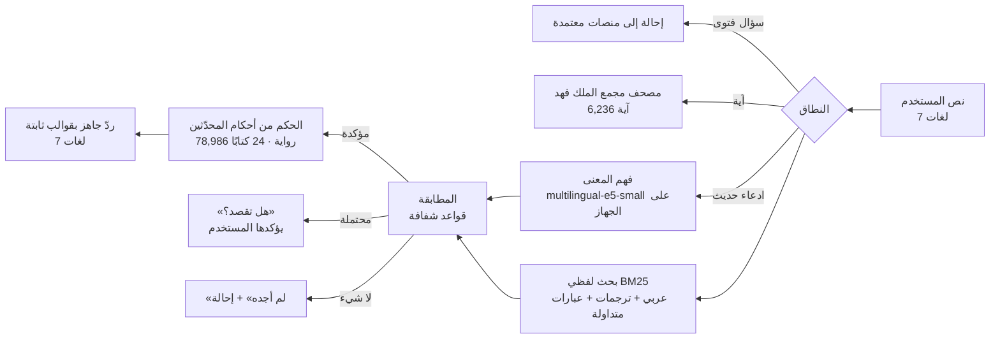

<div dir="rtl">

# تبيَّن — Tabayyan

**تحقّق من الحديث قبل أن تنشره.**
أداة مدعومة بالذكاء الاصطناعي، يلصق فيها المستخدم أي كلام منتشر منسوب إلى النبي ﷺ — بالعربية أو الإنجليزية أو الفرنسية أو الأردية أو الإندونيسية أو الصينية أو السواحيلية — فتعيده إلى نصه العربي، وتُظهر موضعه في كتب السنة وأحكام المحدّثين عليه، وتكتب ردًّا جاهزًا بلغة السائل. وإن لم تجده قالت «لم أجده» وأحالت إلى مختص.

**الرابط الحي:** https://tabayyan.hefoacc.workers.dev
**المسار:** 04 — أدوات المعرفة والتحقق لتمكين المعرّفين بالإسلام · تحدي الذكاء الاصطناعي في خدمة المحتوى الإسلامي

> *English abstract — Tabayyan verifies circulating sayings attributed to the Prophet ﷺ in seven languages. An on-device multilingual embedding model (multilingual-e5-small, ONNX/WebAssembly) maps the user's text to the original Arabic narration across ~79k records; transparent rules decide the match; the grading is always quoted from named hadith scholars, never generated. No server, no tracking, works offline.*

---

## المحتويات
1. [المشكلة](#المشكلة) · 2. [الحل](#الحل) · 3. [آلية العمل](#آلية-العمل) · 4. [الذكاء الاصطناعي](#الذكاء-الاصطناعي) · 5. [قواعد المطابقة والحكم](#قواعد-المطابقة-والحكم) · 6. [المنهج والمرجعية العلمية](#المنهج-والمرجعية-العلمية) · 7. [البيانات والمصادر](#البيانات-والمصادر) · 8. [النتائج والقياس](#النتائج-والقياس) · 9. [التشغيل والنشر](#التشغيل-والنشر) · 10. [بنية المستودع](#بنية-المستودع) · 11. [الاختبارات وبوابة الجودة](#الاختبارات-وبوابة-الجودة) · 12. [الخصوصية والأمان](#الخصوصية-والأمان) · 13. [القيود وخطة الاستمرار](#القيود-وخطة-الاستمرار) · 14. [الرخص](#الرخص)

---

## المشكلة
يصل إلى المعرّف بالإسلام سؤال: «هل هذا حديث صحيح؟» ومعه عبارة مترجمة. ليجيب عليه أن:
1. يصل من العبارة المترجمة إلى **أصلها العربي**،
2. ويجد **موضعها** في كتب السنة و**حكم المحدّثين** عليها،
3. ثم يشرح النتيجة **بلغة السائل**.

المشكلة ليست ترجمة؛ بل الوصول من صياغة مترجمة — قد تكون محرّفة أو مختصرة — إلى رواية يمكن التحقق منها. أدوات البحث الحديثي عربية اللفظ، والنماذج اللغوية العامة قد تختلق حديثًا أو حكمًا.

## الحل
| المدخل | ما يحدث | المخرج |
|---|---|---|
| نص بأي لغة من سبع | فهم المعنى على الجهاز + بحث في ~79 ألف رواية | **النص العربي** كما في المصدر |
| | مطابقة بقواعد شفافة | **الحكم** منقولًا عن محدّث مسمّى، مع **الكتاب والرقم** وتعليق المصنّف |
| | قوالب ثابتة | **ردّ جاهز** بلغة السائل، يُنسخ بنقرة أو يُشارك برابط |

وحالات خاصة: **«لم أجده»** حين يغيب النص (لا حكم دون مصدر) · **«هل تقصد؟»** حين يفهم الذكاء الاصطناعي المعنى دون ثقة كافية · **«آية قرآنية»** حين تُنسب آية إلى السنة · **«خارج النطاق»** لأسئلة الفتوى مع الإحالة.

## آلية العمل


كل الطبقات تعمل **داخل المتصفح**: القاعدة، والفهارس، والنموذج، والقوالب. الخادم يقدّم ملفات ثابتة فقط.

## الذكاء الاصطناعي
| البند | القيمة |
|---|---|
| النموذج | `multilingual-e5-small` (intfloat) — نسخة ONNX مكمّمة int8 (Xenova)، رخصة MIT |
| البنية | BERT/XLM-R: 12 طبقة، أبعاد 384، مفردات 250k، ~118 ميغابايت |
| اللغات | نحو 100 لغة، منها السبع المدعومة |
| التشغيل | Transformers.js 4.3 + ONNX Runtime Web (WebAssembly) — يُخدَم من الموقع نفسه، بلا اتصال خارجي |
| الفهرس | 50,540 متجه رواية + 213 صيغة لعبارات متداولة، int8 (~20 ميغابايت) |
| زمن الاستعلام | 100–160 ملّي ثانية في المتصفح بعد التحميل |
| التحقق الشامل | اختبار متصفح آلي بالنموذج الحقيقي دون أي اتصال خارجي: الصينية والسواحيلية والإندونيسية والأردية |

**«الجسر الإنجليزي»:** يربط النموذج الصينية والسواحيلية والفرنسية والأردية والإندونيسية بالإنجليزية أقوى بكثير من ربطها بالعربية الفصحى؛ لذلك نُمثّل كل رواية بكلام النبي ﷺ من ترجمتها المعتمدة حين توجد، وبمتنها العربي حين لا توجد، ثم نعود دائمًا إلى المتن العربي والحكم.

**قرار الذكاء الاصطناعي (`public/engine.js → aiDecide`) — مُعايَر على مجموعة الاختبار:**
| الحالة | الشرط | ما يحدث |
|---|---|---|
| اعتماد تلقائي | عبارة متداولة بتشابه ≥ 0.93 وتتقدّم على التالية · أو رواية بتشابه ≥ 0.94 وتبرز عن خلفية النتائج ≥ 0.05 | يصبح المتن العربي «أصلًا» ويُبحث عنه في المصادر |
| اقتراح | فوق عتبة اللغة (الصينية 0.845، الإنجليزية والعربية 0.90، غيرها 0.89) | «هل تقصد؟» — لا حكم حتى يؤكد المستخدم |
| امتناع | تحت العتبة | «لم أجده» |

**الذكاء الاصطناعي لا يحكم على أي حديث.** دوره الفهم والوصول إلى الأصل؛ والحكم يُستخرج برمجيًا من أحكام المحدّثين المخزّنة.

## قواعد المطابقة والحكم
- **المطابقة:** تغطية موزونة بندرة الكلمات ≥ 80% مع كلمتين متتاليتين مشتركتين = «مطابق»؛ 55–80% = «قريب المعنى». كلما قلّت كلمات المستخدم ارتفعت نسبة التطابق المطلوبة، ويُشترط تقارب الكلمات.
- **الحكم (`public/logic.js → decide`):**
  - ما في الصحيحين: «صحيح».
  - طريق واحد مقبول عند كل المحققين المعتمدين يكفي لثبوت الحديث، ولا يضره ضعف طرقه الأخرى.
  - اختلاف المحققين في الرواية نفسها: «مختلف فيه» مع عدد القابلين والرادّين، دون ترجيح آلي.
  - ضعف رواية أطول تحوي العبارة **لا ينتقل** إلى العبارة؛ والصحة تنتقل.
  - لم يوجد إلا لفظ قريب: «بلفظ آخر» مع عرض اللفظ الثابت.
- **تعريفات المصطلح** (صحيح، حسن، ضعيف، موضوع…) تظهر تحت كل حكم على طريقة ابن الصلاح وابن حجر.

## المنهج والمرجعية العلمية
- منهج أهل السنة والجماعة على فهم السلف الصالح، وفق المعتمد في المملكة العربية السعودية؛ المرجع في الحديث الموسوعة الحديثية بالدرر السنية.
- **الأئمة المقدَّمون:** الإمام البخاري، الإمام مسلم، الإمام أحمد بن حنبل، الإمام مالك، شيخ الإسلام ابن تيمية.
- **المحققون المعاصرون المعتمدون:** الألباني، ابن باز، ابن عثيمين، اللجنة الدائمة، المعلمي اليماني، أحمد شاكر، مقبل الوادعي، حماد الأنصاري، عبد المحسن العباد، عبد القادر الأرناؤوط، زبير علي زئي، سليم الهلالي.
- كل ذلك في ملف واحد: `public/policy.js` — روجِع شرعيًا.

**المطابقة مع «المرجعية والحزمة العلمية والبيانات» للتحدي:**
| البند | التطبيق |
|---|---|
| لا يُنسب حديث دون مصدر وحكم معتمد | كل حكم مقرون بالمحدّث والكتاب والرقم |
| مقاومة الهلوسة | الامتناع و«هل تقصد؟» عند انخفاض الثقة؛ لا توليد |
| التمييز بين القطعي والاجتهادي | «مختلف فيه» مع الأعداد |
| عدم الاستقلال بالفتوى | تمييز أسئلة الفتوى وإحالتها إلى ابن باز وابن عثيمين والإسلام سؤال وجواب |
| الآية المنقولة على أنها حديث | تمييزها وعرضها من مصحف مجمع الملك فهد بالرسم العثماني |
| الترجمة والتوطين | لا يُقتبس إلا من ترجمات منصات جمعية خدمة المحتوى الإسلامي باللغات |
| الشفافية والخصوصية | إفصاح دائم؛ لا جمع بيانات |

## البيانات والمصادر
| المصدر | المحتوى |
|---|---|
| الكتب السبعة (hadith-api) | 35,982 رواية بأحكام المحققين وترجماتها (إنجليزي، فرنسي، أردو، إندونيسي) |
| مسند الإمام أحمد (Open-Hadith-Data، ODbL) | 26,363 رواية؛ ترجمات إنجليزية مربوطة بمطابقة النص العربي |
| الدارمي والجوامع (hadith-json) | الدارمي، رياض الصالحين، بلوغ المرام، المشكاة، الأدب المفرد، الشمائل، الأربعينات |
| كتب الموضوعات (NAH، MAHADDAT — CC BY 4.0) | 3,294 حديثًا موضوعًا وضعيفًا بتعليقات مصنّفيها (الشوكاني، السيوطي، الجورقاني…) |
| مصحف مجمع الملك فهد | 6,236 آية (حفص) + خط المصحف العثماني |
| عبارات متداولة | 63 عبارة بأصولها العربية (`public/data/phrases.json`) |
| الموسوعة الحديثية — الدرر السنية | عبر `/api/dorar` عند النشر على Cloudflare Pages |

تفاصيل الرخص في [`DATA-LICENSES.md`](DATA-LICENSES.md).

## النتائج والقياس
**مجموعة الاختبار** (`test/gold.json`، 70 حالة بسبع لغات، تشمل حالات سلبية):
| | بدون الذكاء الاصطناعي | مع الذكاء الاصطناعي |
|---|---|---|
| حكم مباشر صحيح | 47/48 | **59/70** |
| حكم خاطئ | **0** | **0** |
| وجد ما لا يجب أن يوجد | **0** | **0** |
| «هل تقصد؟» والاقتراح الأول صحيح | — | **10/10** (تُحسم بنقرة) |
| الحسم الكلي (حكم مباشر + اقتراح صحيح) | — | **69/70** |

**الأداء:** القاعدة جاهزة في ~1.4 ث على الحاسب و~5.5 ث على جوال متوسط (محاكاة) · الذكاء الاصطناعي جاهز في ~9 ث على الحاسب (أول مرة، ثم من ذاكرة المتصفح) · استعلام < 1.3 ث.
**الإتاحة:** 0 مخالفات WCAG 2 AA (axe) في 20 حالة · **العمل دون اتصال:** بعد أول زيارة.

## التشغيل والنشر
**المتطلبات:** Node.js 18+.
```bash
npm install                 # المكتبات (للبناء والاختبار فقط)
npm run fetch:model         # النموذج إلى public/models (مرة واحدة) — مرفق في حزمة الإطلاق
npm run build:ai            # متجهات الذكاء الاصطناعي (~20 دقيقة على حاسب عادي)
npm run release             # فهارس + اختبارات + قياس الذكاء الاصطناعي + بناء dist/
npm run preview             # تجربة نسخة الإنتاج: http://localhost:8788
```
**النشر:**
- **حزمة جاهزة:** `tabayyan-dist.zip` يحوي `dist/` كاملًا (مع النموذج المجزّأ) — ارفعوه كما هو.
- **Cloudflare Workers (الحالي):** ارفعوا محتوى `dist/` أصولًا ثابتة بالطريقة نفسها التي نُشر بها الموقع الحالي.
- **Cloudflare Pages:** `npm run deploy` — ويُفعَّل معه وسيط الدرر `/api/dorar`.

الملفات الأكبر من 25 ميغابايت (النموذج، وبيئة ONNX) تُقسَّم تلقائيًا عند البناء وتُجمَّع في المتصفح.

**اختياري:** `ICADB_TOKEN=… npm run import:icadb` أو `npm run import:hadeethenc` لاستيراد الترجمات والشروح المعتمدة؛ `CONTACT_EMAIL` في `policy.js` لإظهار زر «أبلغ عن خطأ».

## بنية المستودع
```
public/                 الموقع (يعمل كاملًا في المتصفح)
  index.html · about.html · 404.html · manifest.webmanifest · sw.js · _headers
  app.js                الواجهة وتسلسل التحقق
  engine.js             البحث عبر اللغات، المطابقة، قرار الذكاء الاصطناعي، بحث المتجهات
  logic.js              التطبيع العربي، BM25، تصنيف الأحكام، القرار النهائي
  semantic.js           تحميل النموذج وتشغيله على الجهاز
  scope.js              تمييز الآيات وأسئلة الفتوى وطلبات اختيار الأحاديث
  replies.js            قوالب الرد بسبع لغات
  binindex.js           ترميز الفهارس الثنائية وفكّها
  policy.js             المنهج والعتبات (ملف المراجعة الشرعية)
  data/                 القاعدة، الترجمات، الفهارس، المصحف، العبارات، متجهات الذكاء الاصطناعي
  models/ · vendor/     النموذج، Transformers.js، ONNX Runtime
functions/api/          وسيط الدرر وicadb (Cloudflare Pages)
lib/                    محللات الدرر وicadb
tools/                  البناء، الفهارس، المتجهات، القياس، الاستيراد، بوابة الإطلاق
test/                   اختبارات الوحدات والتكامل + مجموعة الاختبار الذهبية
```

## الاختبارات وبوابة الجودة
```bash
npm test                    # 7 مجموعات: محلل الدرر، الأحكام، المحرك، الذكاء الاصطناعي، النطاق والآيات، الفهارس
npm run eval -- --ai        # مجموعة الاختبار مع النموذج الحقيقي، وتوزيع درجات التشابه
npm run check -- --ai       # بوابة الإطلاق
```
**بوابة الإطلاق ترفض النشر** إذا فشل اختبار، أو ظهر حكم خاطئ أو مطابقة لا يجب أن تكون، أو نزل الاسترجاع عن 90%، أو كانت الفهارس أو المتجهات أقدم من القاعدة. وGitHub Actions يشغّلها مع كل دفع.

## الخصوصية والأمان
- لا حسابات، ولا ملفات تعريف ارتباط، ولا تتبع. النص لا يغادر الجهاز.
- لا اتصال بأي طرف ثالث وقت التشغيل: النموذج وبيئته يُخدَمان من الموقع (`connect-src 'self'`).
- ترويسات CSP وHSTS وX-Frame-Options؛ لا أسرار في الكود.
- سياسة خصوصية معلنة في صفحة «عن تبيَّن».

## القيود وخطة الاستمرار
- النموذج صغير ليعمل على الجوال؛ في الصينية تحديدًا يأتي التشابه منخفضًا، فتظهر «هل تقصد؟» بدل الحكم المباشر — عمدًا.
- الشروح المترجمة تحتاج استيراد HadeethEnc أو القاعدة المركزية (icadb).
- **التالي:** ربط القاعدة المركزية للجمعية، توسيع العبارات المتداولة بمراجعة شرعية، تجربة ميدانية مع المعرّفين، إضافة متصفح وبوت واتساب، وقياس الزمن وجودة الردود.

## الرخص
الكود: [MIT](LICENSE). البيانات والخطوط والمكوّنات: [`DATA-LICENSES.md`](DATA-LICENSES.md).

</div>
